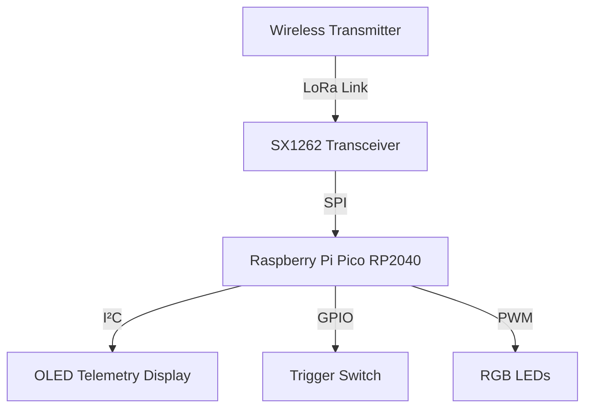
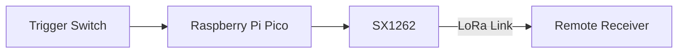

# 📡 AeroLink

**A LoRa-based wireless telemetry and remote command system built on the Raspberry Pi Pico.**


---

## 👋 About the Project

AeroLink is a hands-on embedded systems project that I built to learn how microcontrollers, LoRa radios, displays, and physical inputs work together in a single system.

It runs on a **Raspberry Pi Pico (RP2040)** with an **SX1262 LoRa transceiver** and an **SSD1306 OLED display**, all programmed in **MicroPython**. The device listens for wireless telemetry, shows the important values on screen, and lets you send a **Stop** command back over the air with the press of a physical switch.

Through this project I got practical experience with:

- Microcontroller programming in MicroPython
- LoRa wireless communication
- Handling and parsing sensor/telemetry data
- Interfacing hardware over SPI, I²C, GPIO, and PWM

---

## ✨ Features

| Feature | Description |
|---|---|
| 📶 **LoRa Communication** | Wireless link using the SX1262 transceiver |
| 📥 **Telemetry Reception** | Receives and monitors incoming packets |
| 📊 **RSSI Monitoring** | Measures received signal strength for every packet |
| 🖥️ **OLED Status Display** | Shows system status and telemetry values live |
| 🔘 **Stop Command Switch** | A physical trigger switch sends a Stop message over LoRa |
| 💡 **RGB LED Feedback** | Visual indicators for system state |
| 🧩 **Modular Drivers** | Separate, reusable radio and display drivers |

---

## ⚙️ How It Works

1. On startup, the Pico initializes the **LoRa transceiver** and the **OLED display**, then enters its main loop.
2. When a wireless message arrives, the program:
   - reads the payload,
   - records the **RSSI** value,
   - updates the **OLED display**, and
   - increments the **received-packet counter**.
3. The **battery information** and the **transmitter's packet count** are extracted from specific fields in the received message.
4. If the **trigger switch** is pressed, the Pico transmits a **Stop** message through the LoRa transceiver.

---

## 🏗️ System Architecture



**Command path:**



---

## 🔧 Hardware Components

| Component | Purpose |
|---|---|
| Raspberry Pi Pico (RP2040) | Main microcontroller |
| SX1262 LoRa Module | Wireless communication |
| SSD1306 OLED Display | Displaying received information |
| Trigger Switch | Initiating the Stop command |
| RGB LEDs | Visual status indication |
| Jumper wires & power supply | Hardware connections |

**Tech stack:** MicroPython · Raspberry Pi Pico · SX1262 LoRa · SPI & I²C · GPIO & PWM · Thonny IDE

---

## 🔌 Pin Connections

### SX1262 LoRa Module

| Signal | Pico GPIO |
|---|---|
| SCK | GP10 |
| MOSI | GP11 |
| MISO | GP12 |
| CS | GP13 |
| IRQ | GP14 |
| RESET | GP15 |
| BUSY (GPIO) | GP16 |

### OLED Display

| Signal | Pico GPIO |
|---|---|
| SDA | GP0 |
| SCL | GP1 |

### Trigger Switch & LEDs

| Component | Pico GPIO |
|---|---|
| Trigger switch | GP2 |
| Red LED | GP8 |
| Green LED | GP7 |
| Blue LED | GP9 |
| Onboard LED | GP25 |

---

## 📻 LoRa Configuration

| Parameter | Value |
|---|---|
| Frequency | 868 MHz |
| Bandwidth | 250 kHz |
| Spreading factor | 12 |
| Coding rate argument | 5 |
| Sync word | `0x12` |
| Transmit power | 22 dBm |
| Preamble length | 8 |
| CRC | Enabled |
| Header mode | Explicit |

---

## 📁 Project Structure

```
aerolink-lora-telemetry/
├── main.py            # Main application
├── receive_only.py    # Simple receiver test program
├── sx1262.py          # SX1262-specific radio driver
├── sx126x.py          # Shared SX126x driver implementation
├── _sx126x.py         # Low-level commands, constants, and registers
├── ssd1306.py         # OLED display driver
└── ssd1305.py         # Additional OLED driver
```

| File | What it does |
|---|---|
| `main.py` | Telemetry reception, display updates, and Stop-command transmission |
| `receive_only.py` | Basic receiver for testing message reception and RSSI |
| `sx1262.py` | SX1262-specific radio driver |
| `sx126x.py` | Shared SX126x driver implementation |
| `_sx126x.py` | Low-level radio commands, constants, and register definitions |
| `ssd1306.py` | OLED display driver |
| `ssd1305.py` | Additional OLED driver |

---

## 🚀 Getting Started

### Requirements

- Raspberry Pi Pico (RP2040)
- Compatible SX1262 LoRa module
- SSD1306 OLED display
- MicroPython firmware
- Thonny IDE

### Setup

1. Install **Thonny IDE**.
2. Flash compatible **MicroPython firmware** onto the Pico.
3. Wire up the SX1262 module, OLED display, switch, and LEDs using the [pin table](#-pin-connections) above.
4. Upload these files to the Pico:
   - `main.py`
   - `sx1262.py`
   - `sx126x.py`
   - `_sx126x.py`
   - `ssd1306.py`
5. Open `main.py` in Thonny and run it.
6. Use a compatible LoRa transmitter to send test messages.

> 💡 **Tip:** Not ready to test the full system? Run `receive_only.py` first to confirm that your radio is receiving messages and reporting RSSI correctly.

---

## ⚠️ Current Limitations

AeroLink currently focuses on the basics: telemetry reception, RSSI monitoring, OLED updates, and Stop-command transmission.

The following still need further development and testing:

- Reliable command delivery
- Acknowledgements
- Authentication
- Fail-safe behavior

> **Important:** AeroLink is an **experimental** embedded communication project. It is **not** a safety-certified emergency-stop or flight-control system and should not be used as one.

---

## 🏁 Conclusion

AeroLink was a practical way for me to explore wireless telemetry and embedded hardware integration. It brings together a Raspberry Pi Pico, LoRa communication, an OLED display, and a physical input to form a compact monitoring and command system, and it gave me a solid foundation for building more reliable wireless projects in the future.
